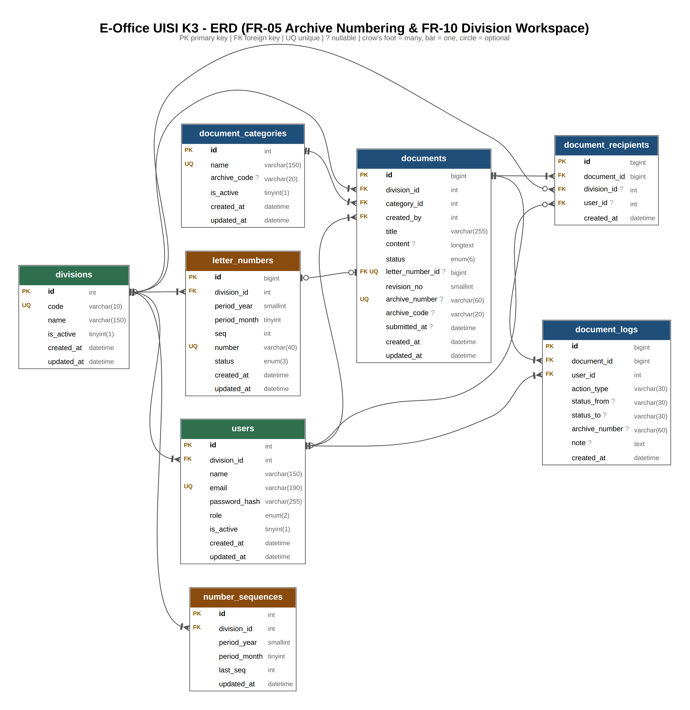

# eoffice-uisi-k3

E-Office web app backend (Node.js + Express + MySQL 8).
Implemented so far: **FR-10** division workspaces and **FR-05** archive numbering (including the FR-02 transaction lock).



## Setup

```bash
cp .env.example .env      # fill in DB_PASSWORD and JWT_SECRET
npm install
npm run db:migrate        # apply db/migrations
npm run db:seed           # dummy divisions, users, archive-code catalog
npm run dev               # http://localhost:3000
```

`npm run db:fresh` drops every table, then migrates and seeds again.
`npm run erd` regenerates `docs/erd.svg` and `docs/erd.png` from the live schema (needs `google-chrome`).

Dummy users (password `password123`): `ki.kepala@uisi.test` (HEAD), `ki.staf@uisi.test`, `ki.staf2@uisi.test`, and the same pattern for `keu.` and `sdm.`.

## Tests

The integration tests wipe the database they run against, so they only run when `DB_NAME` ends in `_test` or `ALLOW_DB_RESET=1` is set:

```bash
DB_NAME=eofficeuisi_test npm test   # preferred: a separate database
ALLOW_DB_RESET=1 npm test           # uses DB_NAME from .env; reseed afterwards with npm run db:fresh
```

## Archive number rules (FR-05)

Format: `{seq}/{DIVISION_CODE}/{MM}.{YY}`. For example, the 5th document of division KI in December 2026 is `5/KI/12.26`.

- The number is generated **on submit only**: when a staff member submits to their head of division, or when a head of division submits their own document. Drafts never have a number.
- The sequence is per division and resets every calendar month. The month is decided in `APP_TZ` (default `Asia/Jakarta`).
- **Revision**: the head requests a revision, the author fixes and resubmits, and the document keeps its number with a suffix: `5/KI/12.26/REV.1`, then `REV.2`, and so on.
- **Reject / cancel** before approval: the number goes back to the pool. The next submission in the same division and month reuses the lowest released number first.
- **Approve**: the number becomes `USED` and is never recycled.
- A category whose archive code is not configured blocks submission with `Kode arsip kategori belum dikonfigurasi`.
- Concurrency: the division-month row in `number_sequences` is locked (`SELECT ... FOR UPDATE`) while a number is issued, so concurrent submissions queue up. Any failure rolls the transaction back, so no number is lost.

## Workspace rules (FR-10)

- `users`, `documents`, `number_sequences` and `letter_numbers` all reference `divisions`.
- A document's `division_id` always comes from the logged-in user, never from the request.
- `GET /api/documents` only returns the user's own division. Drafts are visible only to their author.
- Opening another division's document returns **404** unless a `document_recipients` row grants that user or division access (the KORIN access that FR-11 will create).

## API

All endpoints except login need `Authorization: Bearer <token>`.

| Method | Path | Who | Notes |
|---|---|---|---|
| POST | `/api/auth/login` | anyone | `{ email, password }` → `{ token, user }` |
| GET | `/api/auth/me` | any user | |
| GET | `/api/documents?status=&limit=&offset=` | any user | own division only |
| POST | `/api/documents` | any user | `{ title, content?, category_id }` → DRAFT |
| GET | `/api/documents/:id` | own division / KORIN recipient | 404 otherwise |
| PATCH | `/api/documents/:id` | author | DRAFT, REVISION_REQUESTED, REJECTED |
| POST | `/api/documents/:id/submit` | author | generates the number, or the `/REV.n` suffix |
| POST | `/api/documents/:id/request-revision` | HEAD of division | `{ note }`, keeps the number |
| POST | `/api/documents/:id/reject` | HEAD of division | `{ note }`, releases the number |
| POST | `/api/documents/:id/cancel` | author | releases the number |
| POST | `/api/documents/:id/approve` | HEAD of division | finalizes the number (stand-in until FR-11/12 signing) |
